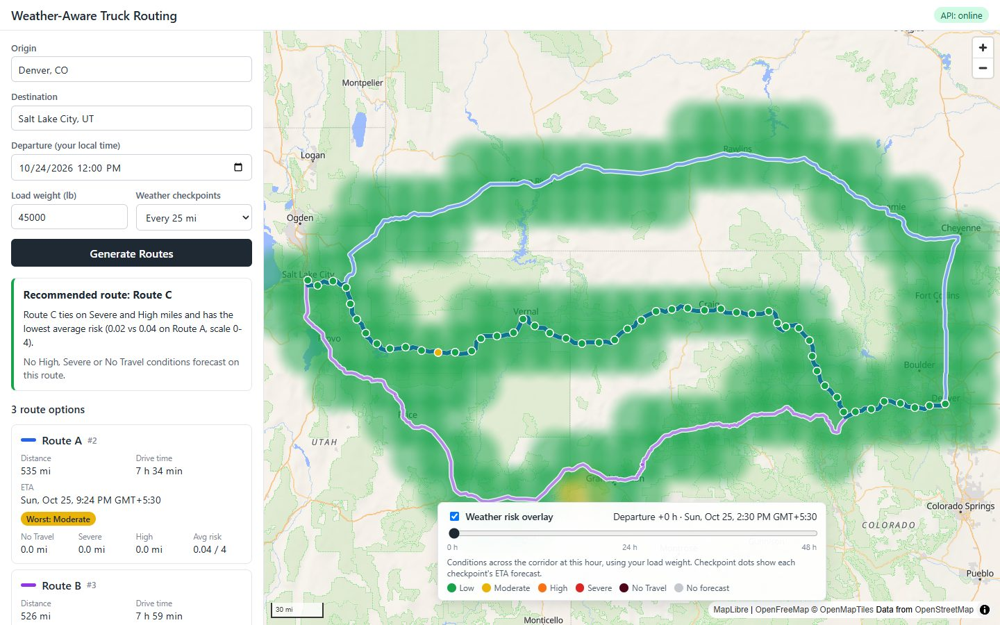
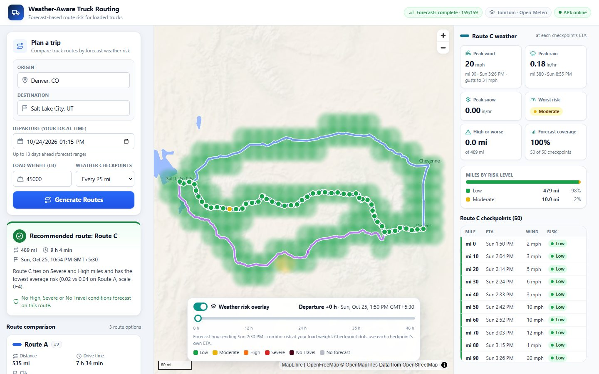
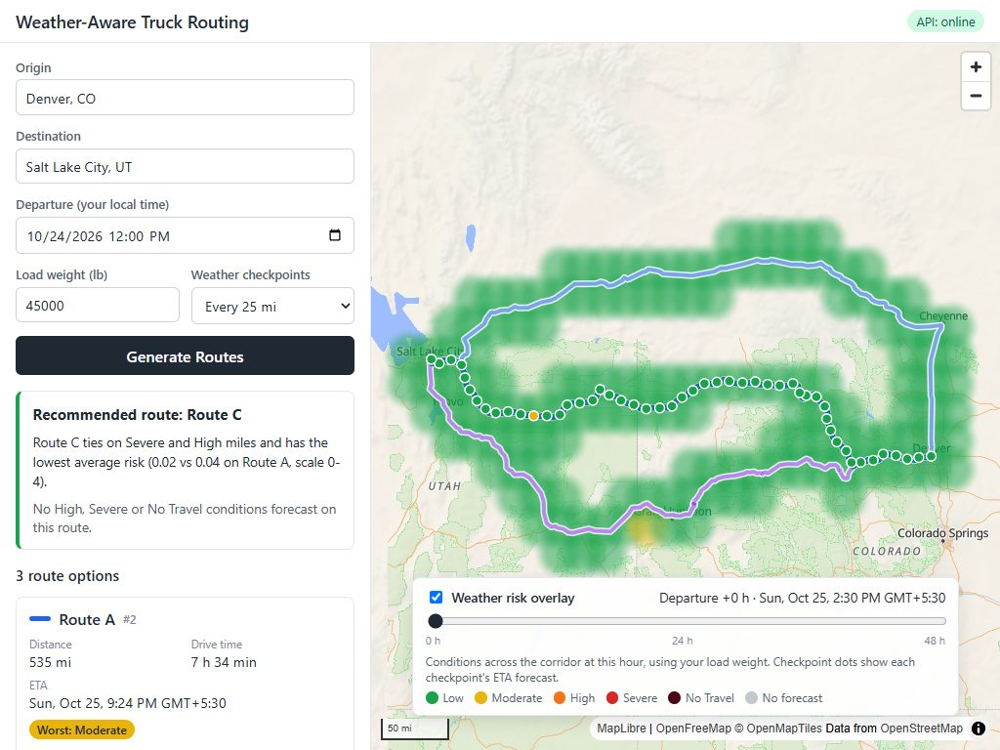
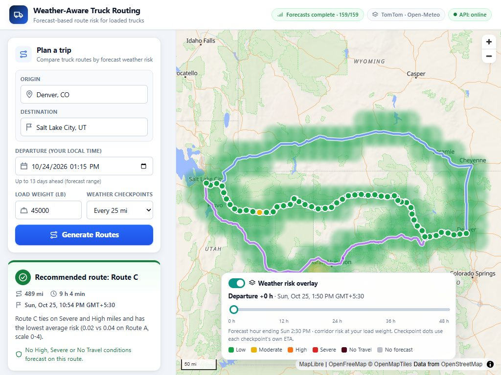
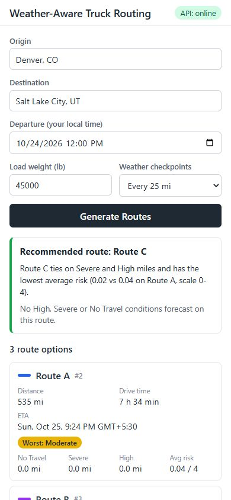
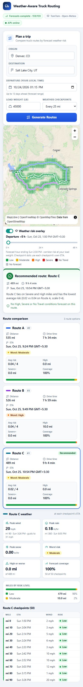
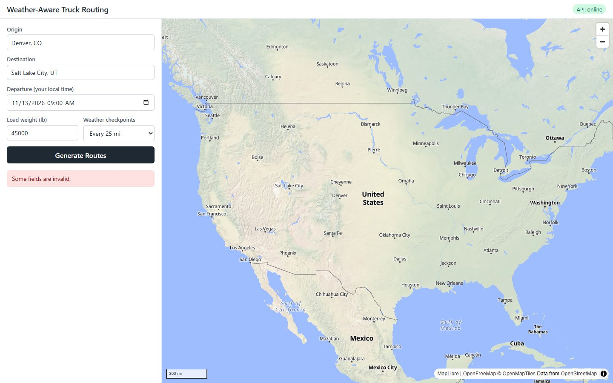
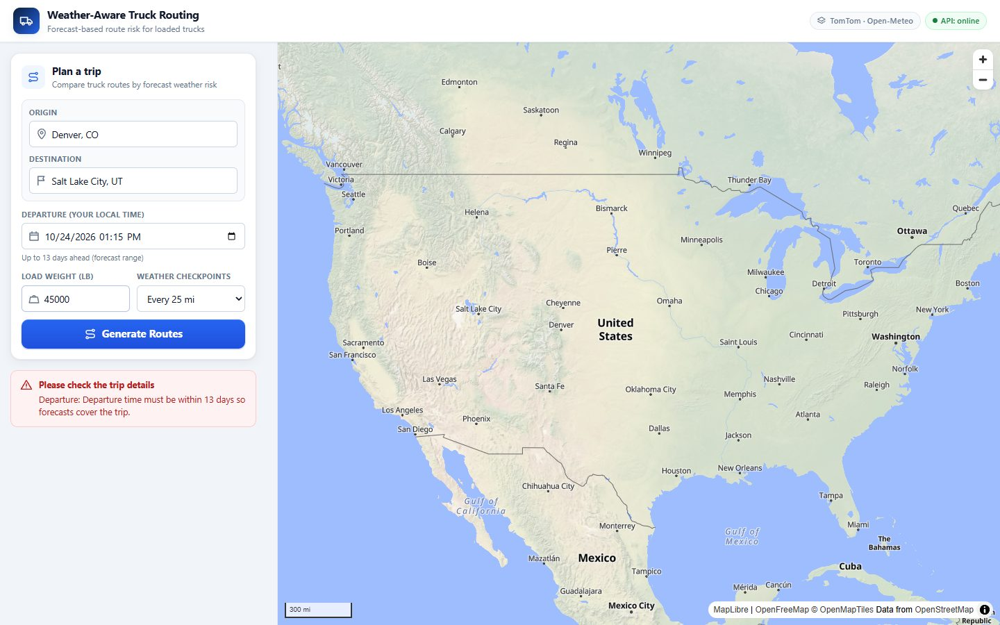

# QA Audit Report: Weather-Aware Truck Routing

**Date:** 2026-10-24 · **Baseline:** commit `e4e4904` · **Scope:** data accuracy,
calculation verification, browser QA, UI redesign, responsive layout.

Nothing here is estimated. Every result below comes from a command that was
actually run, and the commands are listed in [§9](#9-automated-test-results).
Tests that use **mocked** data are marked as such, and so are tests that call
the **live** providers (TomTom, Open-Meteo).

---

## Summary

| Area | Result |
|---|---|
| Live data audit (independent re-derivation) | **5 live trips**, 58–75 checks each. The final like-for-like runs on a fresh-cache backend passed **58/58** and **75/75**. All checkpoint weather values matched Open-Meteo exactly. |
| Risk thresholds and load rules | Unchanged; verified by 109 boundary tests and a live re-classification of 400+ checkpoints |
| Recommendation ranking | Independently recomputed on every live trip: order, `decided_by` and explanation numbers all match |
| Bugs found in the app | **11** found and fixed (B8–B11 in the addenda above), each with a regression test; plus 1 data-provenance improvement |
| Provider behaviour discovered | 2 Open-Meteo findings, documented in the README |
| Automated tests | Backend **408**, Vitest **71**, Playwright mocked **20/20**, Playwright live **1/1** (before the daily quota ran out); `tsc` 0 errors; lint 0 issues; build OK |
| Responsive | 6 viewports: no horizontal overflow, no clipped content, map ≥ 300 px tall |

---

## Addendum 2: "shading shows Severe but the checkpoint shows Low" and "weather unavailable" (2026-10-24 15:29–15:49 IST)

**Report 1.** Near Albuquerque, the shading at departure +35 h was red, but
the popup for the checkpoint there said Low, "even after sliding".

**Finding: not a data error, a UI clarity bug (B10).**
- The checkpoint popup shows the forecast at the truck's **ETA**, which was
  about +4–7 h.
- The shading shows the corridor at the **slider hour**, +35 h.
- These are different times, so colours can legitimately differ. Both
  values were verified earlier (every cell's colour matched its own values;
  checkpoints matched Open-Meteo at their ETA).

But the UI made this easy to misread:
- The slider was labelled "Departure +35 h", which read as if it changed
  the departure time.
- Shaded cells couldn't be inspected.
- Nothing linked a checkpoint to the same hour of shading.

**Fixes:**
- **Clearer label.** The slider now reads **"Shading at departure +N h"**.
  The note explains: "Shading = area risk at this hour (click it for
  details). Dots = risk when the truck reaches each checkpoint, so they can
  differ."
- **Clickable shading.** Clicking a shaded area opens that cell's
  forecast for the selected hour: risk, wind, rain, snow, the cell's
  location and size, and the time. The popup updates live as the slider
  moves, and missing data says "Unknown", never Low.
- **"Show shading at this ETA (+N h)"** in both the checkpoint popup and
  the detail panel. It jumps the slider to the exact frame using the same
  forecast hour as the checkpoint (frame times and checkpoint
  `forecast_time` are compared exactly).
- **Hour comparison in the detail panel.** It now says whether the shading
  shows the checkpoint's hour or a different one.
- **One map popup at a time.** A cell popup and a checkpoint popup no
  longer overlap.

**Regression tests:**
- Vitest: `frameForForecastHour`, `cellForecast`, cell and checkpoint popup
  DOM (jsdom), and the CheckpointList relation messages and sync button.
- Playwright: `checkpoint vs shading time: explanation and "show shading at
  this ETA"`, which covers the sidebar and map-popup buttons, with the
  slider value checked.
- Visual check on recorded real data: a cell popup at +35 h, live update
  when sliding to +12 h, and the sync to +4 h showing "Map shading shows
  this checkpoint's forecast hour".

**Report 2.** Dallas, GA plan: "forecast and weather unavailable".

**Finding.** A direct probe returned `429 "Daily API request limit exceeded.
Please try again tomorrow."`: this machine's daily Open-Meteo quota is used
up (see the first addendum). The app behaved safely: it showed no weather and
recommended nothing. But its message, "rate limit … Try again shortly", was
misleading (**B11**).

**Fix.** The message now names the limit Open-Meteo reports:
- **daily:** "Forecasts will be available again after 00:00 UTC";
- **hourly:** "Try again within the hour";
- **per-minute:** "Try again in a minute".

pytest: `test_rate_limit_message_names_the_limit` (3 cases).

**Results after these fixes:** backend **411 passed**; Vitest **79
passed**; `tsc` 0 errors; lint 0; build OK; Playwright mocked **21/21**.

---

## Addendum: long trips showed "Forecasts unavailable · 0/945" (reported 2026-10-24 14:06 IST)

**Symptom.** Portland → New York with 3 routes at 10 mi showed every
checkpoint as "No forecast" and no recommendation. The message was "The
weather provider's rate limit was reached."

**Root cause (measured).** Open-Meteo counts **every location** against its
600-calls-per-minute free limit. Counting the real TomTom routes for this
trip, without calling Open-Meteo:

| Interval | Checkpoints | Locations needed per plan (before fix) |
|---|---|---|
| 10 mi | 933 | **1,090** (over the per-minute limit on its own) |
| 25 mi | 376 | 566 |
| 50 mi | 190 | 384 |

There were two defects:
- **B8:** a single long plan could exceed the provider limit by itself.
- **B9:** the forecast fetch was all-or-nothing, so one rate-limited batch
  discarded every forecast.

**Fix.**
- **Per-plan budget.** Each plan is capped at **500 locations**
  ([weather.py](backend/trips/weather.py)). Checkpoints get priority, and
  the heatmap gets what's left: 60–200 points, now a hard cap
  ([corridor.py](backend/trips/domain/corridor.py)).
- **Coarser grid only when needed.** If a trip needs more distinct
  checkpoint forecast points than fit, the lookup grid coarsens just enough.
  Checkpoints and ETAs still fall every N miles. The response reports
  `forecast_grid_degrees` and each `forecast_point`, and the UI explains it.
- **Partial results.** A rate-limited batch now blanks only its own
  locations, which are shown as unknown, never Low
  ([open_meteo.py](backend/trips/providers/open_meteo.py)
  `fetch_hourly_partial`).

**Live verification** (real TomTom and Open-Meteo, fresh-cache backend):

| Run | Result |
|---|---|
| Before the strict heatmap cap: 10 mi | 940/940 checkpoints; but 610 locations (heatmap 214 > its budget), with one 429 |
| After: 10 mi | **940/940 checkpoints, 483 locations (≤ 500)**, lookup grid 0.4° (about 44 km: three ~3,000-mi routes cannot be sampled more finely within the limit), heatmap 84 points complete, recommendation given |
| After: 25 mi | 461 locations, grid 0.05°; **277/379** checkpoints. One batch hit Open-Meteo's **daily** limit, and the partial handling kept the rest and still recommended, with a coverage warning |

**Important for today.** That last 429 was `Daily API request limit
exceeded`. This machine's daily Open-Meteo quota (10,000 location-calls) was
used up, largely by this audit's own live runs and investigation. Until
00:00 UTC (05:30 IST), live plans from this machine will show forecasts as
unavailable. That is the correct, safe behaviour, but it isn't representative
of the app.

**Regression tests (all pass):**
- `test_snap_step_*`
- `test_heatmap_gets_remaining_budget`
- `test_rate_limited_chunk_only_blanks_its_own_locations`
- `test_max_points_is_a_hard_cap_for_continental_corridors` (3 budgets)
- `test_normal_plan_uses_fine_grid_within_budget`
- `test_plan_needing_too_many_points_coarsens_lookup_grid_but_keeps_every_checkpoint`
  (checks requested locations ≤ budget)
- `test_rate_limited_batch_gives_partial_forecasts_not_zero`
- Vitest: the grid notice is shown or hidden.

Also changed: the loading text now gives realistic timings. Coast-to-coast
plans took 47–71 s, mostly TomTom computing long alternatives, so the old
"usually 5–10 s" was misleading. The Playwright default is now one worker
(see §9).

---

## 1. Bugs identified

| # | Severity | Area | Bug | Evidence |
|---|---|---|---|---|
| B1 | High | API integration | **Server validation reasons were hidden.** A departure 20 days ahead returned `400` with `"Departure time must be within 13 days so forecasts cover the trip."`, but the UI only said *"Some fields are invalid."* The form also had no date limits matching the backend's window. | Browser probe on the current UI; see [before screenshot](qa/screenshots/before/before-server-validation.jpg) |
| B2 | Medium | Data labelling | **The heatmap slider label showed the forecast hour as "Departure +N h".** With a 13:20 departure, "+0 h" was labelled with the 14:00 forecast-record time. The brief warns not to mix forecast offsets with clock times this way. | Browser probe: API `frame_times[0]` 09:00Z vs departure 08:20Z, label showed 09:00Z |
| B3 | Low | UI/API consistency | **Durations were formatted differently in two places**: the explanation said `3 h 00 min`, the cards `3 h`. Python's `round()` uses banker's rounding (`round(0.5) = 0`) while JavaScript's `Math.round(0.5) = 1`, so durations ending in exactly 30 s could differ by a minute. | Found by the new regression test (`30 s` case failed) |
| B4 | Medium | Map | **Routes were cut off after planning at ≥ 1440 px.** The route-weather column appears in the same render, but MapLibre learns the new container size asynchronously, so `fitBounds` used the old width. | Draft screenshot: Denver was off-screen |
| B5 | Low | Data display | **A small missing-data share could read "0%".** For example, 0.4% missing showed as "0% of the corridor has no forecast". | Code review; regression test |
| B6 | Medium | Responsive UX | **On phones the map came after the form, the recommendation and every route card**, so the user had to scroll a long way to reach it. | [before 390 px](qa/screenshots/before/before-results-390x844.jpg) |
| B7 | Low | Interaction/a11y | **The overlay switch's hidden checkbox sat beneath its visual track.** The label still toggled it, but the input wasn't the top-most click target, and automation couldn't click it. | Playwright: ` intercepts pointer events` |

Also improved (not a bug): **forecast provenance.** Each checkpoint now reports
`forecast_point`, the 0.05° grid point whose forecast was used. Without it, an
independent audit re-snapping the 5-dp coordinate picked the neighbouring
grid point for 1 of 171 checkpoints that sat on a half-cell boundary (§3).

**Not app bugs.** These came from the test tooling and were fixed there: a
Playwright selector that also matched the `<select>`'s `<option>`s, a missing
wait for map readiness, and audit tolerance and request-window choices.

## 2. Bugs fixed

| # | Fix | Files | Regression tests |
|---|---|---|---|
| B1 | Field-level reasons shown with readable labels; departure `min`/`max` plus a client-side check that mirrors the backend window | [apiErrors.ts](frontend/src/lib/apiErrors.ts), [ErrorNotice.tsx](frontend/src/components/ErrorNotice.tsx), [TripForm.tsx](frontend/src/components/TripForm.tsx), [datetime.ts](frontend/src/lib/datetime.ts) | Vitest: `ErrorNotice … field reasons`, `departure window` (4 cases), `API error descriptions`; Playwright: `server validation errors show the field reason`, `client-side validation messages` |
| B2 | Slider shows *departure + N h* (real time) and, separately, the *forecast hour* used | [heatmap.ts](frontend/src/lib/heatmap.ts) `frameLabel`, [HeatmapControl.tsx](frontend/src/components/HeatmapControl.tsx) | Vitest: `shows departure + N h, not the forecast hour`, `heatmap frame labels`; Playwright: `heatmap slider …` |
| B3 | Backend explanation uses the frontend's duration format, with half-up rounding | [presenters.py](backend/trips/presenters.py) `_hours` | pytest: `test_duration_text_matches_frontend_format` (8 cases mirroring the Vitest cases) |
| B4 | `map.resize()` before `fitBounds` | [BaseMap.tsx](frontend/src/components/BaseMap.tsx) | Verified in the [after 1440 screenshot](qa/screenshots/after/after-results-1440x900.jpg) (all routes visible) |
| B5 | `formatShare()` never rounds a non-zero share to 0% (`<1%`, `>99%`) | [insights.ts](frontend/src/lib/insights.ts) | Vitest: `never rounds a small missing share down to 0%`, `formatShare` (5 cases) |
| B6 | Single-column layout puts the map right after the planner | [index.css](frontend/src/index.css), [App.tsx](frontend/src/App.tsx) | Playwright: `layout at 390x844`, `layout at 768x1024` |
| B7 | Transparent input placed above the track | [index.css](frontend/src/index.css) | Playwright: `heatmap slider … toggle` |
| Provenance | `forecast_point` added to each checkpoint | [presenters.py](backend/trips/presenters.py), [services.py](backend/trips/services.py), [types.ts](frontend/src/api/types.ts) | pytest: `test_checkpoint_eta_and_forecast_hour_alignment` asserts it is the nearest 0.05° point |

The risk thresholds, load rules and ranking rules were **not** changed.

## 3. Data accuracy verification

The tool is [qa/audit_live_plan.py](qa/audit_live_plan.py), which uses only
the Python standard library and imports **no application code**. It sends one
real `POST /api/trips/plan/` and then recomputes every value independently:
- forecasts are re-fetched directly from Open-Meteo for the **same grid point,
  the same hour and the same request window** as the app used;
- risk levels come from its own implementation of the PDF table;
- summaries, ranking and the heatmap are recomputed from the API's own data.

### Live runs (real TomTom + Open-Meteo)

| Trip | Interval / load | Routes / checkpoints | Result |
|---|---|---|---|
| Dallas → Denver | 25 mi / 42,000 lb | 2 / 70 | 55/56: one failure from audit rounding tolerance (2-dp `mile` vs 3-dp segment bound), not an app bug; tolerance corrected |
| Denver → Salt Lake City | 10 mi / 45,000 lb | 3 / 159 | **73/73** |
| Dallas → Oklahoma City | 50 mi / 30,001 lb | 3 / 19 | **74/74** |
| Dallas → Denver (fresh-cache backend, final audit) | 10 mi / 45,000 lb | 2 / 171 | **58/58** |
| Denver → Salt Lake City (fresh-cache backend, final audit) | 25 mi / 30,001 lb | 3 / 66 | **75/75** |

Before those final runs, intermediate Dallas → Denver runs scored **54/56**
and **55/57**. Investigating them showed three causes, none of them an app
calculation error:
1. The audit re-fetched with a *different request window*, which runs into
   the model hand-over effect described below.
2. One checkpoint sat on a half-cell rounding boundary, so the audit
   re-snapped it to a neighbouring grid point. This was fixed by the
   `forecast_point` field.
3. Open-Meteo rate-limited the audit itself.

The comparison was then made like-for-like, and the final runs passed in
full.

### What each run verifies

| Category | Check | Status |
|---|---|---|
| Route data | `distance_miles` = metres ÷ 1609.344 (1 dp) | ✅ |
| | Duration = arrival − departure | ✅ |
| | Geometry starts at origin and ends at destination (< 2 km) | ✅ |
| | Provider distance vs drawn-geometry length within 2% | ✅ (e.g. 881.9 vs 882.3 mi) |
| | Alternatives: ids unique; `notice` set only when fewer than 3 routes | ✅ (Dallas → Denver returned 2) |
| Checkpoints | Count for the 10/25/50 mi interval; marks at 0, N, 2N…, plus destination | ✅ |
| | Segments contiguous, start at 0, end at route length; boundaries are midpoints | ✅ |
| | Σ segment miles = route miles (e.g. 882.318 vs 882.32) | ✅ |
| | Every checkpoint lies on the drawn route | ✅ max 18 m off |
| ETAs | First = departure, last = arrival, non-decreasing | ✅ |
| | Implied speed between checkpoints | ✅ 33–79 mph |
| | `forecast_time` = UTC hour containing the ETA | ✅ |
| Weather | Values equal a direct Open-Meteo fetch at the same point, hour and window | ✅ exact on every final-run checkpoint |
| | Rain = `rain + showers`; snow = `snowfall`; wind = sustained 10 m; gusts separate | ✅ |
| | Units checked on every app response (`mp/h`, `inch`) | ✅ (unit tests reject km/h, cm, mm) |
| | Forecast point ≤ 4 km from checkpoint | ✅ max 3.13 km |
| | Unavailable checkpoints carry no weather or risk, plus an "unknown, not low" warning | ✅ (also covered by pytest end-to-end tests with mocked nulls and outages) |
| | Temperature | N/A: not fetched or displayed anywhere |
| | Timezones: API sends ISO 8601 with offsets; UI formats in the viewer's zone | ✅ Playwright compared UI text with in-page formatting of API timestamps |
| Heatmap | 49 frames; frame *h* = UTC hour containing departure + *h* | ✅ |
| | Points on the declared lattice and within the corridor | ✅ |
| | Every cell's risk code matches its own wind/rain/snow (8,379 cells on one trip) | ✅ 0 mismatches |
| | Sampled cells (12 points × 4 frames) equal direct Open-Meteo values | ✅ |
| | `null` risk ⇔ `null` weather | ✅ |

### Provider behaviour discovered (Open-Meteo)

1. **Each location counts against the rate limit.** Bursts of 100-location
   requests returned `429 Minutely API request limit exceeded`. One plan uses
   about 200–550 locations, so 2–3 uncached plans in one minute can be
   rate-limited. The app handles this as designed: weather is marked
   unavailable and nothing is recommended. Documented in the README.
2. **Model hand-over hour.**
   - At the hour where Open-Meteo's series switches from NOAA HRRR to GFS
     (about 39 h ahead), the value differs depending on whether a request
     *ends* on that hour or continues past it. The test was 5 points × 9
     leads; only the hand-over lead differed, for both `best_match` and
     `gfs_seamless`.
   - The app always requests one continuous window, so its values are
     internally consistent.
   - The audit now requests the same window as the app and reports the
     effect separately as an informational check.

## 4. Risk calculation verification

The rules are unchanged from the assessment PDF: [risk.py](backend/trips/domain/risk.py).

| Check | Evidence |
|---|---|
| Every threshold edge: wind 24.99/25/34.99/35/44.99/45/54.99/55; rain 0.0999/0.10/0.2499/0.25/0.4999/0.50/1.00/1.0001; snow 0.499/0.5/…/3.0/3.001 | `test_risk.py`, **109 tests** (pass) |
| Load rules (45–54 mph and > 30,000 lb → No Travel; 35–44 mph and > 40,000 lb → Severe; ≥ 55 always No Travel) at 30,000 / 30,000.01 / 40,000 / 40,001 lb | `test_risk.py` (pass) |
| Load rules only upgrade, and never touch rain or snow | `test_risk.py` (pass) |
| Overall = max of wind (after load rules), rain and snow | `test_risk.py`, live audit (pass) |
| Pipeline: 46 mph + 38,000 lb → No Travel; same storm at 30,000 lb → Severe only | `test_plan_weather.py` (pass) |
| Live re-classification of every checkpoint and heatmap cell by the independent classifier | Live audit: 0 mismatches |
| Segment miles, High miles, Severe-or-worse miles, distance-weighted average, unknown miles | Live audit recomputation; `test_recommendation.py`, 22 tests |
| Unknown weather is never Low: excluded from buckets and the average, flagged, and no recommendation when no data at all | pytest (`test_forecast`, `test_recommendation`, `test_plan_weather`); Vitest; Playwright `weather unavailable …`, `unavailable checkpoint is shown as unknown, not Low` |
| Frontend labels and colours match backend codes; "No forecast" ≠ Low; badge contrast ≥ 4.5:1 (WCAG AA) | Vitest `risk palette`, `badge colours are accessible` (6 cases) |

Live trips had no wind above 26.6 mph, so the load rules didn't fire on real
data. They are covered by the deterministic tests above.

## 5. Route recommendation verification

| Check | Result |
|---|---|
| Ranking = independent sort by (No Travel?, Severe-or-worse mi, High mi, average risk, travel time), stable on ties | ✅ all 5 live trips |
| `decided_by` = first criterion separating #1 and #2 | ✅ (live: `average_risk`, `travel_time`, `severe_miles`, `high_miles`) |
| Explanation numbers match the routes (average risks and travel times) | ✅ e.g. "(2 h 53 min vs 3 h 20 min on Route C)" |
| Card `rank` and `recommended` flags agree with the ranking | ✅ |
| `no_safe_route` if and only if every route has No Travel | ✅ |
| Tie-breaking, missing weather, all-unknown routes, single route, float noise | pytest `test_recommendation.py` and `test_presenters.py` (pass) |
| UI recommendation heading, explanation and card metrics equal the API values | Playwright live journey (pass); mocked `loading state, then route cards …` (pass) |

## 6. UI improvements implemented

| Area | Before | After |
|---|---|---|
| Header | Title and API badge | Brand mark, subtitle, status pills (API, forecast coverage `N/M`, providers) |
| Trip planner | Plain fields | Card with icons; origin and destination grouped; departure limits and hint; prominent primary button with spinner |
| Layout | 2 columns; on mobile the map came last | 3 columns ≥ 1440 px (planner and results · map · route weather); 2 columns on laptops; map right after the planner on phones |
| Recommendation | Text panel | Status-coloured card (recommended, no safe route, unavailable) with distance, drive time, ETA, explanation and hazard list |
| Route cards | Distance, time, ETA, worst level, 4 risk numbers | Adds average risk, High and Severe+ miles, **forecast coverage**, status tag (Recommended, Least exposure, Unsafe: No Travel) and a miles-by-risk bar (unknown miles hatched) |
| Weather dashboard | None | **Route weather panel**: peak wind (with gust), rain and snow, each with its mile and ETA; worst risk; High-or-worse miles; coverage; miles-by-level legend; hazard stretches. All derived from checkpoint data, showing "No forecast" rather than 0. |
| Checkpoints | Plain list | Table (mile, ETA, wind, risk) with a risk-coloured accent, plus a detail card that mirrors the map popup |
| Map | Heavy heatmap (0.5 opacity); small dots | Softer heatmap (0.36 / 0.2 unknown) under the routes; white halo on the selected route; larger dots; popup with a risk-coloured accent; empty-state card; loading pill with real elapsed seconds |
| Heatmap control | Checkbox, slider, mislabelled time | Switch, filled slider with 0/12/24/36/48 h scale, correct departure + N h label, forecast-hour note, missing-data warning, legend |
| Errors | Generic message | Titled notices with field-level reasons; no-route, provider, network and weather-unavailable states |
| Icons and type | None; system font | Hand-drawn inline SVG icon set (no dependency); tabular numbers for metrics; design tokens (navy and slate text, white surfaces, blue and teal accents) |

## 7. Before and after screenshots

Results views use the **same recorded real API response** (Denver → Salt
Lake City), so the two sets are directly comparable. `fixture-*` images show
deterministic **test data**, used to demonstrate the No Travel and unknown
states that today's real weather didn't produce.

| View | Before | After |
|---|---|---|
| 1440 × 900 results |  |  |
| 1024 × 768 results |  |  |
| 390 × 844 (full page) |  |  |
| Server validation error |  |  |

More "after" views:
- [empty state](qa/screenshots/after/after-empty-1440x900.jpg)
- [loading](qa/screenshots/after/after-loading-1440x900.jpg)
- [checkpoint popup](qa/screenshots/after/after-popup-1440x900.jpg)
- [slider at +30 h](qa/screenshots/after/after-slider-30h-1440x900.jpg)
- [live journey](qa/screenshots/after/after-live-journey-1440.jpg)
- [1920](qa/screenshots/after/after-results-1920x1080.jpg), [1366](qa/screenshots/after/after-results-1366x768.jpg), [768](qa/screenshots/after/after-results-768x1024.jpg)
- [fixture: No Travel and unknown, 1440](qa/screenshots/after/fixture-results-1440x900.jpg), [fixture 390](qa/screenshots/after/fixture-results-390x844.jpg)

The screenshots contain no secrets: the UI never displays keys.

## 8. Responsive testing

Playwright test: [responsive.e2e.ts](frontend/e2e/responsive.e2e.ts). It uses
**mocked** data, and every viewport passed in both full runs.

| Viewport | Layout | Horizontal overflow | Clipped elements | Map |
|---|---|---|---|---|
| 1920 × 1080 | 3 columns | 0 | 0 | ✅ |
| 1440 × 900 | 3 columns | 0 | 0 | ✅ |
| 1366 × 768 | 2 columns (weather panel in sidebar) | 0 | 0 | ✅ |
| 1024 × 768 | 2 columns | 0 | 0 | ✅ |
| 768 × 1024 | 1 column, map after the planner | 0 | 0 | ✅ full width |
| 390 × 844 | 1 column, map after the planner | 0 | 0 | ✅ full width |

Each viewport also checks that the recommendation, route options, overlay
and slider are visible, and that the console shows no errors.

## 9. Automated test results

All of these were run on 2026-10-24 after the final change.

| Suite | Command | Data | Result |
|---|---|---|---|
| Backend | `backend\.venv\Scripts\python.exe -m pytest` | Mocked HTTP; network blocked | **408 passed** |
| Frontend unit and component | `npm test` | Fixtures | **71 passed** (4 files) |
| TypeScript | `npx tsc -b` (app, node and e2e projects) | n/a | 0 errors |
| Lint | `npm run lint` (oxlint; the project uses oxlint, not ESLint) | n/a | 0 warnings or errors |
| Build | `npm run build` | n/a | Succeeds (Vite chunk-size warning for MapLibre) |
| Browser, mocked | `npm run test:e2e` | **Mocked API**; tiles from OpenFreeMap | **20 passed** (1 worker). With 2–3 parallel workers on this machine, map-load waits were flaky under CPU contention, so 1 worker is now the default |
| Browser, live | `E2E_LIVE=1 npm run test:e2e:live` | **Live** TomTom and Open-Meteo through the backend | **1 passed** (passed on 3 separate runs) |
| Live data audit | `qa/audit_live_plan.py` | **Live** | Final runs **58/58** and **75/75** (§3) |

**Backend tests by file:**

| File | Tests |
|---|---|
| test_risk | 109 |
| test_tomtom_client | 55 |
| test_api | 47 |
| test_units_geometry | 29 |
| test_checkpoints | 26 |
| test_open_meteo | 24 |
| test_presenters | 24 |
| test_forecast | 23 |
| test_recommendation | 22 |
| test_plan_weather | 12 |
| test_weather | 12 |
| test_corridor | 10 |
| test_health | 2 |

**What the browser tests cover:**
- the empty state;
- geocoding, including keyboard selection and no-match;
- client validation and server field errors;
- no-route, provider and network errors;
- the loading state;
- card metrics against the API;
- route switching, and popup against the detail panel;
- unknown checkpoints;
- the heatmap slider and toggle;
- weather unavailable;
- repeated submissions;
- map zoom and pan;
- the six viewports.

Every test fails if the browser logs a page or console error.

## 10. Remaining limitations

- **Open-Meteo quota.** Per-location counting (§3) means 2–3 uncached plans
  in a minute can be rate-limited. The free tier is also non-commercial. A
  shared cache and request backoff would help.
- **Fewer routes.** TomTom may return fewer than 3 routes.
- **Approximate forecasts.** Forecasts are approximate in space (grid cells,
  0.05° snapping) and at the hand-over hour (§3).
- **Simplified ETAs.** No driver breaks or hours-of-service rules. Times are
  shown in the viewer's time zone.
- **Not deployed.** Production HTTPS settings and `NUM_PROXIES` are still to
  do (see README › Deployment).
- **Bundle size.** The bundle is about 1.3 MB (369 kB gzipped), mostly
  MapLibre.
- **Load rules untested live.** They weren't triggered by real weather
  during this audit and are verified by deterministic tests only.
- **Headless WebGL timings.** Slider updates took 26–138 ms under software
  WebGL; real-GPU smoothness wasn't measured.

## 11. Assessment readiness

| Requirement (PDF) | Status |
|---|---|
| Origin and destination, departure, load weight inputs | ✅ |
| 3 route options from a routing API | ✅ up to 3 real TomTom routes; never padded |
| Weather every 10 / 25 / 50 mi at the checkpoint ETA | ✅ verified live |
| Risk with the provided risk and load rules | ✅ verified by boundary tests and live re-classification |
| Recommendation (Severe → High → average → time) | ✅ verified live; No Travel handled safety-first |
| Map with routes, checkpoints, risk, ETAs, summaries | ✅ |
| Corridor heatmap with a 0–48 h slider | ✅ |
| GitHub repository | ✅ (remote configured) |
| Hosted application, Loom walkthrough | ❌ not done; outside this audit's scope |

**Verdict:** the application is functionally complete and its data was
verified against the live providers. The UI is now dashboard-grade and
responsive. Deployment and the walkthrough remain.
