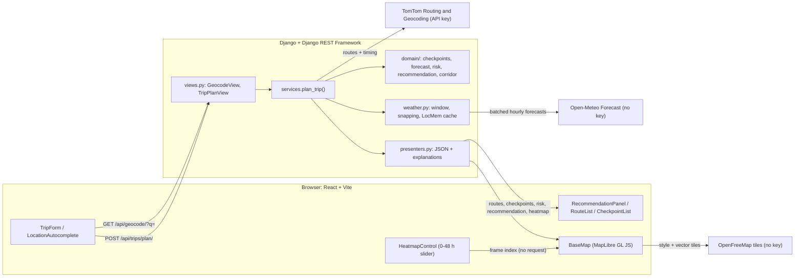

# Weather-Aware Truck Routing

A full-stack web app that helps a truck driver choose between alternative
routes. It forecasts the weather each route will meet at the time the truck
is expected to get there, classifies wind, rain and snow risk using the truck's
load weight, and recommends the safest option. Routes, checkpoints, risk and a
0–48 hour corridor weather heatmap are shown on an interactive map.

**Technology stack at a glance**

- **Frontend:** React 19 + TypeScript 6 + Vite 8
- **Backend:** Python 3.12+, Django 6.1 + Django REST Framework 3.18
- **Mapping:** MapLibre GL JS 6 + OpenFreeMap vector tiles ("Liberty" style)
- **Routing and geocoding:** TomTom Routing API (truck mode) + TomTom Geocoding API
- **Weather:** Open-Meteo hourly forecast API
- **Testing:** pytest + pytest-django + responses (backend); Vitest + Testing Library + jsdom (frontend); Playwright browser tests (mocked and live); oxlint; independent live data audit ([qa/audit_live_plan.py](qa/audit_live_plan.py))

> **Project status:** the features are implemented and tested locally. The app
> is **not deployed**: there is no hosted URL yet, and the Loom walkthrough
> isn't recorded.

---

## Contents

1. [Project overview](#project-overview)
2. [Key features](#key-features)
3. [Complete technology stack](#complete-technology-stack)
4. [System architecture](#system-architecture)
5. [How the application works](#how-the-application-works)
6. [Prerequisites](#prerequisites)
7. [Project structure](#project-structure)
8. [Environment variables and API keys](#environment-variables-and-api-keys)
9. [Local installation and setup](#local-installation-and-setup)
10. [API documentation](#api-documentation)
11. [Risk classification and recommendation](#risk-classification-and-recommendation)
12. [Testing and code quality](#testing-and-code-quality)
13. [Deployment guide](#deployment-guide)
14. [Security considerations](#security-considerations)
15. [Known limitations](#known-limitations)
16. [Future improvements](#future-improvements)
17. [Assessment demo checklist](#assessment-demo-checklist)
18. [License](#license)

---

## Project overview

A route that's fastest in clear weather can be dangerous when a strong
crosswind or heavy snow arrives at the same time as the truck. Heavily loaded
trucks are affected even more by high wind.

This app answers one question: **given when I leave and how heavy my load is,
which route exposes me to the least dangerous weather?**

1. The driver enters an origin, a destination, a departure date and time, and
   a load weight in pounds.
2. The backend asks TomTom for up to three truck routes.
3. Along each route it places weather checkpoints every 10, 25 or 50 miles of
   road distance and estimates when the truck reaches each one.
4. It fetches the Open-Meteo forecast for that hour at each checkpoint, and
   classifies wind, rain and snow using the assessment's thresholds and load
   rules.
5. It ranks the routes, explains why the top route wins, and returns a
   corridor heatmap covering the 48 hours after departure.

---

## Key features

| Feature | Status | Where it lives |
|---|---|---|
| Origin and destination search with autocomplete (US) | ✅ Implemented | [LocationAutocomplete.tsx](frontend/src/components/LocationAutocomplete.tsx), `GET /api/geocode/` |
| Departure date and time (browser local time, sent with a UTC offset) | ✅ | [TripForm.tsx](frontend/src/components/TripForm.tsx), [datetime.ts](frontend/src/lib/datetime.ts) |
| Load weight input (lb) | ✅ | [TripForm.tsx](frontend/src/components/TripForm.tsx) |
| Alternative routes: up to 3 real TomTom truck routes, **never padded** | ✅ | [tomtom.py](backend/trips/providers/tomtom.py) |
| Weather checkpoints every **10, 25 or 50 miles** (default 25) | ✅ | [checkpoints.py](backend/trips/domain/checkpoints.py) |
| Estimated arrival time (ETA) at every checkpoint | ✅ | [checkpoints.py](backend/trips/domain/checkpoints.py) |
| Forecast wind, gusts, rain and snow at each checkpoint's ETA | ✅ | [open_meteo.py](backend/trips/providers/open_meteo.py), [forecast.py](backend/trips/domain/forecast.py) |
| Wind, rain and snow risk with load-weight rules | ✅ | [risk.py](backend/trips/domain/risk.py) |
| Route summaries: miles per risk level, unknown miles, average risk | ✅ | [recommendation.py](backend/trips/domain/recommendation.py) |
| Route recommendation with a plain-English explanation and hazard list | ✅ | [recommendation.py](backend/trips/domain/recommendation.py), [presenters.py](backend/trips/presenters.py) |
| Interactive map; each route in its own colour; click a route or card to select it | ✅ | [BaseMap.tsx](frontend/src/components/BaseMap.tsx) |
| Checkpoint risk dots, popups and a checkpoint list with full details | ✅ | [BaseMap.tsx](frontend/src/components/BaseMap.tsx), [CheckpointList.tsx](frontend/src/components/CheckpointList.tsx) |
| Corridor weather-risk heatmap with a **0–48 h after departure** slider | ✅ | [corridor.py](backend/trips/domain/corridor.py), [HeatmapControl.tsx](frontend/src/components/HeatmapControl.tsx) |
| Risk legend; "No forecast" shown separately from Low | ✅ | [RiskLegend.tsx](frontend/src/components/RiskLegend.tsx) |
| Route comparison cards: distance, drive time, ETA, average risk, High and Severe+ miles, forecast coverage, risk-distribution bar | ✅ | [RouteList.tsx](frontend/src/components/RouteList.tsx), [RiskBar.tsx](frontend/src/components/RiskBar.tsx) |
| Route weather panel: peak wind/gust, rain, snow (with mile and ETA), worst risk, High-or-worse miles, coverage, hazard stretches | ✅ | [RouteInsights.tsx](frontend/src/components/RouteInsights.tsx), [insights.ts](frontend/src/lib/insights.ts) |
| Loading (real elapsed time), empty, validation (incl. server field reasons) and error states; service status pills | ✅ | [App.tsx](frontend/src/App.tsx), [apiErrors.ts](frontend/src/lib/apiErrors.ts), [api_errors.py](backend/trips/api_errors.py) |
| Responsive dashboard: 3 columns ≥ 1440 px, 2 columns on laptops/tablets, single column (map right after the form) on phones | ✅ | [index.css](frontend/src/index.css) |
| Hosted deployment | ❌ Not done | See [Deployment guide](#deployment-guide) |

---

## Complete technology stack

Versions are the ones pinned in [`requirements.txt`](backend/requirements.txt)
and [`requirements-dev.txt`](backend/requirements-dev.txt), or installed from
[`package.json`](frontend/package.json) and its lockfile.

| Category | Technology | Purpose |
|---|---|---|
| Frontend language | TypeScript `~6.0.3` | Type-safe UI code, checked by `tsc -b` during the build |
| Frontend framework | React `19.3` (`react`, `react-dom`) | UI components; state uses React hooks only, with no state library |
| Build tool / dev server | Vite `8.3` + `@vitejs/plugin-react` | Dev server on port 5173 that proxies `/api` to Django; production bundling |
| Mapping | `maplibre-gl` `6.15` | WebGL map, with route, checkpoint and heatmap layers and popups |
| Map style and tiles | OpenFreeMap "Liberty" (`https://tiles.openfreemap.org/styles/liberty`) | Base map; no key |
| Geo types | `@types/geojson` | GeoJSON typings for map sources |
| Styling | Plain CSS ([index.css](frontend/src/index.css)) | No UI component library |
| HTTP client | Browser `fetch` in [client.ts](frontend/src/api/client.ts) | Typed API calls, `AbortController` cancellation, uniform `ApiError` |
| Frontend tests | Vitest `5.0`, `@testing-library/react` `16`, `@testing-library/dom`, `jsdom` `30` | Unit tests (Node) and component tests (jsdom) |
| Browser tests | `@playwright/test` `1.64` ([playwright.config.ts](frontend/playwright.config.ts)) | Real Chrome: mocked-API journeys and responsive checks, plus an opt-in live journey |
| Icons | Inline SVG ([Icon.tsx](frontend/src/components/Icon.tsx)) | Drawn for this app; no icon library |
| Frontend lint | `oxlint` `1.8x` ([.oxlintrc.json](frontend/.oxlintrc.json)) | React, TypeScript and oxc rules |
| Backend language | Python **3.12+** (Django 6.1 requires it; developed on 3.13.15) | — |
| Web framework | Django `6.1.2` | Settings, URL routing, middleware; no database or models |
| REST framework | Django REST Framework `3.18.3` | Views, request validation (serializers), throttling, JSON errors |
| CORS | `django-cors-headers` `4.9.0` | Allows the deployed frontend origin to call the API |
| Configuration | `django-environ` `0.14.0` | Reads environment variables and `backend/.env` |
| HTTP client | `requests` `2.34.2` | Calls TomTom and Open-Meteo with explicit timeouts |
| WSGI server (production) | `gunicorn` `26.2.0` | Production server (Linux/macOS; gunicorn doesn't run on Windows) |
| Caching | Django `LocMemCache` (max 10,000 entries) | Forecast responses (30 min) and throttle counters |
| Compression | Django `GZipMiddleware` | Compresses the large plan JSON, about 8× smaller |
| Backend tests | `pytest` `9.1.1`, `pytest-django` `4.14.0`, `responses` `0.26.3` | Tests with mocked HTTP; real network access is blocked |
| Routing | TomTom Routing API v1 `calculateRoute` | Truck routes, alternatives, per-point travel time |
| Geocoding | TomTom Geocoding API (`/search/2/geocode`) | Location suggestions |
| Weather | Open-Meteo Forecast API (`/v1/forecast`) | Hourly wind, gusts, rain, showers, snowfall |
| Package managers | `npm` (frontend), `pip` + `venv` (backend) | — |

### External services

| Service | Role in this app | API key? | Called from |
|---|---|---|---|
| **TomTom Routing API** | Up to 3 truck routes (`travelMode=truck`, `maxAlternatives=2`, `departAt`, `traffic=true`) with full geometry and per-point travel time (`extendedRouteRepresentation=travelTime`, `distance`) | **Yes**: `TOMTOM_API_KEY` | Django only |
| **TomTom Geocoding API** | Autocomplete suggestions (`countrySet=US`, `typeahead=true`, 5 results) | **Yes**: same key | Django only |
| **Open-Meteo** | Hourly forecasts at checkpoints and heatmap points, in mph and inches | No | Django only |
| **OpenFreeMap** | Vector base-map tiles and style; attribution is added automatically by MapLibre | No | Browser |
| **MapLibre GL JS** | Open-source map rendering library bundled with the app (not a hosted service) | No | Browser |

The browser never talks to TomTom or Open-Meteo directly, so the TomTom key
never reaches the frontend.

---

## System architecture



**Frontend and API.** In development, the browser calls relative `/api/...`
URLs and the Vite dev server proxies them to Django at
`http://127.0.0.1:8000` (see [vite.config.ts](frontend/vite.config.ts)). In
production the base URL comes from `VITE_API_BASE_URL`. All calls go through
[client.ts](frontend/src/api/client.ts), and every error is shown from the
API's `{ "error": { "code", "message" } }` body.

**Backend pipeline** (`POST /api/trips/plan/`, [services.py](backend/trips/services.py)):

1. **Validate** the request ([serializers.py](backend/trips/serializers.py)).
2. **Routes.** TomTom returns up to three truck routes. Each has about 10,000
   geometry points plus `progress` anchors of cumulative time and distance
   ([tomtom.py](backend/trips/providers/tomtom.py)).
3. **Checkpoints and ETAs** are computed along the *full* server-side geometry
   ([checkpoints.py](backend/trips/domain/checkpoints.py)).
4. **Location budget and heatmap grid.** Open-Meteo counts every location
   against its 600-per-minute limit, so each plan is capped at **500
   locations**. Checkpoints get priority. The heatmap is a bounded corridor
   grid built from what's left: up to 200 points, at least 60
   ([weather.py](backend/trips/weather.py),
   [corridor.py](backend/trips/domain/corridor.py)).
5. **Forecasts.** One deduplicated, cached forecast lookup covers all
   checkpoint and grid locations: 100 locations per Open-Meteo request, up to
   4 requests in parallel ([weather.py](backend/trips/weather.py),
   [open_meteo.py](backend/trips/providers/open_meteo.py)).
6. **Risk.** Each checkpoint is classified using its arrival-hour forecast
   and the load weight ([forecast.py](backend/trips/domain/forecast.py),
   [risk.py](backend/trips/domain/risk.py)).
7. **Summaries and ranking** follow the assessment's priority order
   ([recommendation.py](backend/trips/domain/recommendation.py)).
8. **Presentation.** The response is shaped as JSON: geometry is simplified
   for display (about 10k → 1k points), and explanations and hazard stretches
   are added ([presenters.py](backend/trips/presenters.py)).

**Heatmap data flow.** The plan response carries the grid coordinates and all
49 hourly frames:
- `risk[frame][point]`, where `null` means no forecast;
- the matching wind, rain and snow values.

The frontend loads every point once, with all 49 frame values stored as
feature properties ([heatmap.ts](frontend/src/lib/heatmap.ts)). Moving the
slider only swaps MapLibre's `circle-color` and `circle-opacity` expressions,
so nothing is re-requested or re-uploaded.

---

## How the application works

### User flow

1. Type an origin and a destination and pick a suggestion. Suggestions appear
   after 2 characters with a 300 ms debounce.
2. Choose the departure time in your local time, enter the load weight in
   pounds, and pick a checkpoint interval (10, 25 or 50 mi).
3. Click **Generate Routes**. The form validates its inputs and shows a
   loading message while the backend works. A cross-country trip takes about
   6–8 s.
4. The sidebar shows:
   - the **recommendation**: which route, why, and its significant hazards;
   - **route cards**: rank, *Recommended* or *Least exposure*, worst risk
     level, No Travel / Severe / High miles, average risk, unknown miles;
   - the **checkpoint list** for the selected route.
5. The map shows every route in its own colour (blue, purple, dark cyan) and
   the selected route's checkpoints as risk-coloured dots. Click a dot or a
   list row to open a popup with the ETA, forecast hour, wind and gusts, rain,
   snow, any load-rule adjustment, the risk level and warnings.
6. Drag the **0–48 h slider** to see corridor conditions N hours after
   departure, or untick the overlay to hide it.

### Checkpoints and arrival times

- **Placement.** Checkpoints are at mile 0, then every *interval* miles of
  road distance along the actual TomTom geometry, plus the destination. If
  the destination is less than 0.5 mi past the last regular checkpoint, it
  replaces that checkpoint. Mile markers use TomTom's own distance scale, so
  they match the route length.
- **Represented distance.** Each checkpoint covers the road from the midpoint
  with its previous checkpoint to the midpoint with its next one. For a 25-mi
  interval, the checkpoint at mile 50 covers mi 25–75. Segments tile the
  route exactly, so **risk miles are distances, not checkpoint counts**.
- **ETA.** Departure time plus the elapsed time at that distance:
  - Elapsed time comes from TomTom's `progress` anchors, interpolated by road
    distance. They include TomTom's traffic prediction for the departure time.
  - If TomTom gives no anchors, time is spread in proportion to distance, and
    the route is flagged `eta_source: "proportional_estimate"`.
  - Driver breaks and hours-of-service rules aren't modelled.

### Weather at each checkpoint

- **Forecast hour.** Open-Meteo rain, showers and snowfall are totals over the
  *preceding* hour. Each checkpoint therefore uses the record whose hour
  contains its ETA: an ETA of 10:20 uses the 11:00 UTC record. Wind is the
  instantaneous value at that time stamp.
- **Inputs:**
  - **wind** is `wind_speed_10m` in mph, sustained wind (`wind_gusts_10m` is
    shown but not scored);
  - **rain** is `rain + showers` in in/hr (liquid precipitation);
  - **snow** is `snowfall` in in/hr.
- **Units** are requested as `mph` and `inch` and checked on every response.
  An unexpected unit is treated as a provider error.
- **Location snapping.** Checkpoint lookups are snapped to a 0.05° grid
  (about 5 km), so nearby checkpoints and overlapping routes share one
  forecast. A very long trip may need more distinct points than the 500
  location budget allows: for example, coast to coast at 10 mi needs about
  890. In that case the lookup grid coarsens just enough (0.1°, 0.15°, …).
  Checkpoints and ETAs stay every N miles; only the forecast point each one
  reads from changes. The response reports `forecast_grid_degrees` and each
  checkpoint's `forecast_point`, and the UI shows a notice.

### Weather and load weight

The risk rules are summarized below and documented fully in
[Risk classification and recommendation](#risk-classification-and-recommendation).
Wind, rain and snow are each classified, and wind may be raised by the load
rules. The checkpoint's overall level is the highest of the three.

### Comparing and recommending routes

Routes without No Travel always rank above routes with it. After that, the
assessment's criteria apply in order: fewest Severe miles, fewest High miles,
lowest average risk, shortest travel time. The explanation names the
criterion that separated the top two routes. For example: *"Route A ties on
all weather-risk criteria and is the fastest (2 h 54 min vs 3 h 22 min on
Route C)."*

### Forecast heatmap and time slider

- **Grid.** A grid aligned to fixed multiples of the spacing covers a
  corridor about 30 km wide around all routes. The spacing is the finest of
  0.1, 0.15, 0.2, 0.25, 0.3, 0.4, 0.5, 0.75 or 1.0° that keeps the grid at
  **≤ 200 points**, or fewer when checkpoints use most of the 500-location
  budget (minimum 60). Short trips get a fine grid, for example 0.15° for Dallas
  → Oklahoma City; long trips get a coarse one, for example 0.5° for Chicago →
  Denver.
- **Frames.** Frame *h* (0–48) is the forecast for **departure + h hours**,
  using the same "hour that contains the moment" rule as checkpoints.
- **Values.** Each cell uses the same risk rules and load weight as the
  checkpoints.
- **Display.** Cells are drawn as soft circles in the risk palette. Cells
  without a forecast are faint grey, and the control reports what share of
  the corridor has no forecast. Checkpoint dots don't change with the slider:
  they always show each checkpoint's own ETA forecast.

---

## Prerequisites

| Software | Version | Why |
|---|---|---|
| Python | **3.12 or newer** (developed on 3.13.15) | Django 6.1.2 requires Python ≥ 3.12 |
| Node.js | **22.12+ or 24.x** (developed on 24.19.0) | Vitest 5 requires `^22.12 \|\| ^24 \|\| >=26`; Vite 8 requires `^20.19 \|\| >=22.12` |
| npm | Bundled with Node (developed on 11.17) | Frontend packages |
| Git | Any recent version | Version control |
| Google Chrome | Any current version | Playwright browser tests use the installed Chrome (`PW_CHANNEL` to change); no browser download needed |
| TomTom developer account | Free tier | `TOMTOM_API_KEY` for routing and geocoding: https://developer.tomtom.com/ |

Open-Meteo and OpenFreeMap need no account.

---

## Project structure

```
weather-prediction/
├── README.md
├── QA_AUDIT_REPORT.md            # data-accuracy audit, browser QA, UI redesign results
├── .gitignore
├── qa/
│   ├── audit_live_plan.py        # independent live audit of every plan value (stdlib only)
│   └── screenshots/              # before/after UI screenshots used in the report
├── backend/
│   ├── manage.py
│   ├── requirements.txt          # runtime dependencies (pinned)
│   ├── requirements-dev.txt      # + pytest, pytest-django, responses
│   ├── pytest.ini                # uses config.test_settings
│   ├── .env.example              # copy to .env (git-ignored)
│   ├── config/
│   │   ├── settings.py           # env-driven settings, DRF, cache, throttles, gzip
│   │   ├── test_settings.py      # fake key + relaxed throttles for tests
│   │   ├── urls.py               # mounts trips.urls under /api/
│   │   └── wsgi.py / asgi.py
│   └── trips/
│       ├── urls.py               # /api/health/, /api/geocode/, /api/trips/plan/
│       ├── views.py              # thin DRF views
│       ├── serializers.py        # request validation and limits
│       ├── services.py           # trip-planning pipeline
│       ├── weather.py            # forecast window, snapping, caching
│       ├── presenters.py         # JSON shaping, explanations, hazard stretches
│       ├── api_errors.py         # uniform {"error": {...}} responses
│       ├── domain/               # pure Python: no Django, no HTTP
│       │   ├── risk.py           # thresholds + load rules
│       │   ├── recommendation.py # summaries + ranking
│       │   ├── checkpoints.py    # placement, segments, ETAs
│       │   ├── forecast.py       # forecast-hour alignment, sample -> risk input
│       │   ├── corridor.py       # bounded heatmap grid
│       │   ├── geometry.py       # haversine, interpolation, simplification
│       │   ├── routes.py         # provider-neutral route/place types
│       │   └── units.py          # metres/miles, km/h -> mph
│       ├── providers/
│       │   ├── tomtom.py         # TomTom client + parsing
│       │   ├── open_meteo.py     # Open-Meteo client + parsing + horizon
│       │   └── errors.py         # user-safe provider errors
│       └── tests/                # pytest suite + TomTom / Open-Meteo mocks
└── frontend/
    ├── package.json              # scripts: dev, build, lint, preview, test, test:e2e, test:e2e:live
    ├── vite.config.ts            # React plugin + /api proxy to :8000
    ├── playwright.config.ts      # browser tests (port 5174, installed Chrome)
    ├── .oxlintrc.json            # lint rules
    ├── .env.example              # VITE_API_BASE_URL (public, not secret)
    ├── index.html
    ├── e2e/                      # Playwright: app.e2e.ts, responsive.e2e.ts (mocked),
    │                             # live.e2e.ts (opt-in), fixtures.ts, helpers.ts
    └── src/
        ├── main.tsx, App.tsx     # dashboard shell and page state
        ├── config.ts             # API base URL, map style, initial view
        ├── index.css             # design tokens + all styles
        ├── api/                  # client.ts (fetch) + types.ts (response types)
        ├── components/           # AppHeader, TripForm, LocationAutocomplete, RecommendationPanel,
        │                         # RouteList, RouteInsights, CheckpointList, HeatmapControl,
        │                         # RiskLegend, RiskBadge, RiskBar, MapStatus, ErrorNotice, Icon,
        │                         # BaseMap (+ components.test.tsx)
        ├── hooks/                # useMediaQuery, useElapsedSeconds
        ├── lib/                  # units, datetime, risk palette, heatmap, checkpoints, insights,
        │                         # apiErrors, routeColors (+ unit tests)
        └── test/fixtures.ts      # shared test data
```

Generated and local-only directories (`backend/.venv`, `frontend/node_modules`,
`frontend/dist`, caches) are git-ignored and not shown.

---

## Environment variables and API keys

### Backend: `backend/.env`

Read by [settings.py](backend/config/settings.py) through `django-environ`.
Real environment variables take precedence over `.env`.

| Variable | Required | Default | Used for |
|---|---|---|---|
| `DJANGO_SECRET_KEY` | **Yes**: Django refuses to start without it | — | Django cryptographic signing |
| `DJANGO_DEBUG` | No | `False` | `True` only for local development |
| `DJANGO_ALLOWED_HOSTS` | No | `localhost,127.0.0.1` | Hostnames the API answers to |
| `CORS_ALLOWED_ORIGINS` | In production | empty | Frontend origin(s) allowed to call the API |
| `TOMTOM_API_KEY` | **Yes**, for geocoding and trip planning | empty (endpoints return `503 provider_not_configured`) | TomTom Routing + Geocoding |

Open-Meteo needs no key.

### Frontend: `frontend/.env.local` (optional)

| Variable | Required | Default | Used for |
|---|---|---|---|
| `VITE_API_BASE_URL` | Only for production builds | `/api` (uses the Vite dev proxy) | API base URL, e.g. `https://api.example.com/api` |

> ⚠️ Every `VITE_*` variable is embedded in the browser bundle and is
> **public**. Never put an API key or secret in the frontend environment.

### Creating the files

```powershell
cd backend
Copy-Item .env.example .env
# Generate a Django secret key and paste it into DJANGO_SECRET_KEY= in backend\.env
.\.venv\Scripts\python.exe -c "from django.core.management.utils import get_random_secret_key as k; print(k())"
notepad .env    # set DJANGO_SECRET_KEY and TOMTOM_API_KEY; keep DJANGO_DEBUG=True locally
```

`backend/.env` is git-ignored. Only the `.env.example` files, which contain
empty placeholders, belong in Git.

---

## Local installation and setup

All commands are for **Windows PowerShell**, run from the repository root
(`weather-prediction`). They call the virtual environment's Python directly,
so you don't need to activate it or change the execution policy.

### 1. Backend (terminal 1)

```powershell
cd backend
python -m venv .venv                                   # or: py -3.13 -m venv .venv
.\.venv\Scripts\python.exe -m pip install --upgrade pip
.\.venv\Scripts\python.exe -m pip install -r requirements-dev.txt
Copy-Item .env.example .env                            # then edit .env (see above)
.\.venv\Scripts\python.exe -m pytest                   # optional: offline test suite
.\.venv\Scripts\python.exe manage.py runserver         # http://127.0.0.1:8000
```

Check it's running: open <http://127.0.0.1:8000/api/health/>. It should
return `{"status": "ok", "service": "weather-aware-truck-routing"}`.

> Restart `runserver` after editing `.env`: the auto-reloader only watches
> Python files. If the API reports `provider_not_configured` although `.env`
> has a key, check that `TOMTOM_API_KEY` isn't set to an empty value in your
> shell (`$env:TOMTOM_API_KEY`), because real environment variables override
> `.env`.

### 2. Frontend (terminal 2)

```powershell
cd frontend
npm install
npm run dev                                            # http://localhost:5173
```

Open <http://localhost:5173>. The header badge should read **API: online**.
The same health check is also available through the proxy at
<http://localhost:5173/api/health/>.

| URL | What |
|---|---|
| http://localhost:5173 | Frontend (Vite dev server) |
| http://127.0.0.1:8000/api/health/ | Backend health check |
| http://127.0.0.1:8000/api/geocode/?q=Dallas | Geocoding (needs `TOMTOM_API_KEY`) |
| http://127.0.0.1:8000/api/trips/plan/ | Trip planning (POST only) |

---

## API documentation

Base path: `/api/`, defined in [config/urls.py](backend/config/urls.py) and
[trips/urls.py](backend/trips/urls.py). Requests and responses are JSON.
There's no authentication. Requests are throttled per client: **60/min** for
geocoding and **10/min** for trip planning.

**Every error** uses the same shape ([api_errors.py](backend/trips/api_errors.py)):

```json
{ "error": { "code": "invalid_request", "message": "Some fields are invalid.", "fields": { "...": ["..."] } } }
```

`fields` appears only for validation errors.

### `GET /api/health/`

Liveness probe. Doesn't call any external service.

```json
{ "status": "ok", "service": "weather-aware-truck-routing" }
```

### `GET /api/geocode/?q=<text>`

US location suggestions for autocomplete, from TomTom, with duplicate labels
collapsed.

| Parameter | Rules |
|---|---|
| `q` (query string) | Required, 2–200 characters after trimming |

```json
{
  "results": [
    { "id": "ATFFDvKyxtf1HepzrswVcQ", "label": "Dallas, TX", "lat": 32.7779765, "lon": -96.7962148, "kind": "Municipality" }
  ]
}
```

No matches returns `{"results": []}` with status 200.

### `POST /api/trips/plan/`

Generates routes, checkpoint forecasts and risk, the recommendation and the
heatmap.

| Field | Type | Rules |
|---|---|---|
| `origin`, `destination` | object `{lat, lon, label?}` | `lat` −90…90, `lon` −180…180, `label` ≤ 200 chars (optional); destination must differ from origin |
| `departure_time` | string | ISO 8601 **with a UTC offset** (`Z` or `-05:00`); from 15 min ago up to **13 days** ahead |
| `load_weight_lb` | number | 0 – 200,000 |
| `checkpoint_interval_miles` | integer | `10`, `25` or `50`; default `25` |

**Example request**, the one used to capture the response below:

```json
{
  "origin": { "lat": 32.7767, "lon": -96.797, "label": "Dallas, TX" },
  "destination": { "lat": 35.4676, "lon": -97.5164, "label": "Oklahoma City, OK" },
  "departure_time": "2026-10-24T07:00:00-05:00",
  "load_weight_lb": 38000,
  "checkpoint_interval_miles": 50
}
```

**Example success response (200).** This is real output captured on
2026-10-23. Arrays are shortened and only the first route and one checkpoint
are shown:

```json
{
  "routes": [
    {
      "id": "rt_9fdb42e7d92f",
      "index": 0,
      "label": "Route A",
      "distance_meters": 331043.0,
      "distance_miles": 205.7,
      "duration_seconds": 10440.0,
      "traffic_delay_seconds": 0.0,
      "departure_time": "2026-10-24T07:00:00-05:00",
      "arrival_time": "2026-10-24T09:54:00-05:00",
      "geometry": { "type": "LineString", "coordinates": [[-96.79702, 32.77664], "..."] },
      "geometry_point_count": { "provider": 3423, "display": 313 },
      "eta_source": "provider_timing",
      "checkpoints": [
        {
          "index": 1,
          "mile": 50,
          "segment_start_mile": 25.0,
          "segment_end_mile": 75.0,
          "segment_miles": 50.0,
          "lat": 33.34306,
          "lon": -97.1815,
          "eta": "2026-10-24T07:46:22-05:00",
          "forecast_time": "2026-10-24T13:00:00+00:00",
          "forecast_point": { "lat": 33.35, "lon": -97.2 },
          "status": "ok",
          "weather": { "wind_mph": 3.3, "wind_gust_mph": 3.4, "rain_in_per_hr": 0.0, "snow_in_per_hr": 0.0 },
          "risk": {
            "overall": "low", "wind": "low", "wind_before_load_rule": "low",
            "rain": "low", "snow": "low", "load_rule_applied": false
          },
          "hazards": [],
          "warnings": []
        }
      ],
      "risk_summary": {
        "total_miles": 205.7,
        "miles_by_level": { "low": 205.7, "moderate": 0.0, "high": 0.0, "severe": 0.0, "no_travel": 0.0 },
        "unknown_miles": 0.0,
        "severe_or_worse_miles": 0.0,
        "average_risk": 0.0,
        "max_risk": "low",
        "has_no_travel": false,
        "coverage_complete": true
      },
      "hazard_stretches": [],
      "rank": 1,
      "recommended": true
    }
  ],
  "route_count": 3,
  "requested_route_count": 3,
  "notice": null,
  "recommendation": {
    "status": "recommended",
    "route_id": "rt_9fdb42e7d92f",
    "route_label": "Route A",
    "ranked_route_ids": ["rt_9fdb42e7d92f", "rt_c5ae277c3015", "rt_35a4540c9548"],
    "decided_by": "travel_time",
    "explanation": "Route A ties on all weather-risk criteria and is the fastest (2 h 54 min vs 3 h 22 min on Route C).",
    "warnings": [],
    "coverage_complete": true
  },
  "weather_risk": {
    "status": "complete",
    "message": "Forecasts are available for every checkpoint.",
    "provider": "Open-Meteo",
    "checkpoints_total": 19,
    "checkpoints_with_forecast": 19,
    "window_start": "2026-10-24T12:00:00+00:00",
    "window_end": "2026-10-26T12:00:00+00:00"
  },
  "heatmap": {
    "status": "complete",
    "spacing_degrees": 0.15,
    "frame_offsets_hours": [0, 1, 2, "...", 48],
    "frame_times": ["2026-10-24T12:00:00+00:00", "2026-10-24T13:00:00+00:00", "..."],
    "lats": ["... 183 values"],
    "lons": ["... 183 values"],
    "risk": [["... 183 values: 0-4, or null = no forecast"], "... 49 frames"],
    "wind_mph": ["... 49 frames x 183 values"],
    "rain_in_per_hr": ["... 49 frames x 183 values"],
    "snow_in_per_hr": ["... 49 frames x 183 values"]
  },
  "inputs": {
    "origin": { "lat": 32.7767, "lon": -96.797, "label": "Dallas, TX" },
    "destination": { "lat": 35.4676, "lon": -97.5164, "label": "Oklahoma City, OK" },
    "departure_time": "2026-10-24T07:00:00-05:00",
    "load_weight_lb": 38000.0,
    "checkpoint_interval_miles": 50
  },
  "provider": { "routing": "TomTom", "travel_mode": "truck", "weather": "Open-Meteo" }
}
```

**Field notes:**

| Field | Values and meaning |
|---|---|
| Risk codes | `low`, `moderate`, `high`, `severe`, `no_travel`. Heatmap `risk` uses scores 0–4, where `null` means no forecast. |
| `checkpoint.status` | `ok` or `unavailable`. When `unavailable`, `weather` and `risk` are `null`. |
| `checkpoint.forecast_point` | The grid point whose forecast was used: 0.05° normally, coarser only for very long trips (see `weather_risk.forecast_grid_degrees`) |
| `checkpoint.hazards` | Which of `wind`, `rain`, `snow` set the overall level (when above Low) |
| `checkpoint.warnings` | Text warnings, e.g. load-rule upgrades, No Travel causes, or "Forecast unavailable … risk is unknown, not low." |
| `hazard_stretches` | Consecutive checkpoints at High or worse with the same level, merged into mile ranges |
| `recommendation.status` | `recommended`, `no_safe_route` (every route has No Travel) or `unavailable` (no forecast data: nothing is recommended) |
| `recommendation.decided_by` | `no_travel`, `severe_miles`, `high_miles`, `average_risk`, `travel_time`, `input_order` (full tie), or `null` (single route) |
| `weather_risk.status` | `complete`, `partial` or `unavailable` |
| `notice` | Set when TomTom returned fewer than 3 routes |

If Open-Meteo fails, the request **still returns 200 with the routes**. Every
checkpoint is `unavailable`, `risk_summary` and `rank` are `null`, and
`recommendation.status` is `"unavailable"`.

**Error responses** (real output):

```jsonc
// 400: validation
{
  "error": {
    "code": "invalid_request",
    "message": "Some fields are invalid.",
    "fields": {
      "departure_time": ["Must include a UTC offset (e.g. 'Z' or '-05:00')."],
      "load_weight_lb": ["Ensure this value is greater than or equal to 0."],
      "checkpoint_interval_miles": ["\"30\" is not a valid choice."]
    }
  }
}

// 503: TOMTOM_API_KEY not set
{ "error": { "code": "provider_not_configured", "message": "The routing provider is not configured on the server." } }

// 405: wrong method
{ "error": { "code": "method_not_allowed", "message": "Method \"GET\" not allowed." } }
```

| Situation | HTTP | `error.code` |
|---|---|---|
| Invalid input | 400 | `invalid_request` (with `fields`) |
| Wrong HTTP method | 405 | `method_not_allowed` |
| Our per-client throttle exceeded | 429 | `throttled` |
| No drivable route between the points | 422 | `no_route_found` |
| TomTom rejected the request | 422 | `provider_rejected_request` |
| `TOMTOM_API_KEY` missing | 503 | `provider_not_configured` |
| TomTom rejected the key (401/403) | 502 | `provider_auth_failed` |
| TomTom rate limit | 503 + `Retry-After: 60` | `provider_rate_limited` |
| TomTom timeout | 504 | `provider_timeout` |
| TomTom unavailable / malformed reply | 502 | `provider_unavailable` / `provider_bad_response` |
| Unexpected server error | 500 | `internal_error` |

---

## Risk classification and recommendation

All rules live in pure Python modules with no Django or HTTP dependencies:
[risk.py](backend/trips/domain/risk.py) and
[recommendation.py](backend/trips/domain/recommendation.py).

### Risk levels

| Level | Score |
|---|---|
| Low | 0 |
| Moderate | 1 |
| High | 2 |
| Severe | 3 |
| No Travel | 4 |

### Thresholds (from the assessment)

| Condition | Low | Moderate | High | Severe | No Travel |
|---|---|---|---|---|---|
| Wind (mph) | < 25 | 25 ≤ w < 35 | 35 ≤ w < 45 | 45 ≤ w < 55 | **≥ 55** |
| Rain (in/hr) | < 0.10 | 0.10 ≤ r < 0.25 | 0.25 ≤ r < 0.50 | 0.50 ≤ r ≤ 1.00 | **> 1.00** |
| Snow (in/hr) | < 0.5 | 0.5 ≤ s < 1.0 | 1.0 ≤ s < 2.0 | 2.0 ≤ s ≤ 3.0 | **> 3.0** |

**Boundary convention:**
- The assessment's ranges share endpoints (for example, rain 0.25 appears in
  both Moderate and High). Each band includes its lower bound and excludes its
  upper bound, so rain 0.25 is High and snow 1.0 is High.
- The assessment lists wind bands as whole numbers, so a value between them
  goes to the lower band: 34.6 mph is Moderate.
- The No Travel edges are exactly as published. Exactly 1.00 in/hr of rain
  and exactly 3.0 in/hr of snow are **Severe**.

### Load-weight rules (wind only; upgrades only)

| Wind | Load | Result |
|---|---|---|
| ≥ 55 mph | any | No Travel |
| 45–54 mph (the Severe band) | **> 30,000 lb** | Severe → **No Travel** |
| 35–44 mph (the High band) | **> 40,000 lb** | High → **Severe** |

- The rules are applied by band membership, so their boundaries match the
  threshold table. "Greater than" is strict: exactly 30,000 lb doesn't
  trigger the upgrade, and 30,000.01 lb does.
- Load rules never lower a level and never affect rain or snow.
- The load weight is **not** sent to TomTom as vehicle weight, because it's
  cargo weight rather than gross vehicle weight.

**Overall checkpoint risk** is the highest of the wind level (after load
rules), the rain level and the snow level.

### Route summary

For each route, using each checkpoint's represented segment miles:

- **Miles per level:** Low, Moderate, High, Severe and No Travel.
- **Unknown miles:** segments without a usable forecast.
- **Severe-or-worse miles:** Severe + No Travel.
- **Average risk:** distance-weighted mean score over *known* miles only,
  from 0 to 4. It's `null` if no mile is known.

### Ranking (in priority order)

| Priority | Criterion | Source |
|---|---|---|
| 0 | **Routes without No Travel rank above routes with No Travel** | Safety-first design decision: the assessment doesn't say how No Travel ranks |
| 1 | Fewest **Severe** miles, counted as Severe-or-worse so No Travel can never make a route look better | Assessment |
| 2 | Fewest **High** miles | Assessment |
| 3 | Lowest **average risk** (a route with no known miles ranks last here) | Assessment |
| 4 | Shortest **travel time** | Assessment |

- **Ties.** Comparisons are deterministic. Miles are compared at 0.01 mi and
  average risk at 1e-6, so floating-point noise can't decide a ranking. A full
  tie keeps TomTom's route order (`decided_by: "input_order"`).
- **No safe route.** If **every** route has No Travel miles,
  `recommendation.status` is `"no_safe_route"`. The explanation starts with
  *"No route is fully safe: every option has No Travel conditions."*, and the
  top route is shown as "least exposure", never as safe.

### Missing or unavailable weather

- **A missing value is never Low.** A checkpoint is `unavailable` if wind,
  rain, showers or snowfall is missing, non-numeric or negative, if the hour
  is outside the forecast window, or if Open-Meteo failed. Missing gusts don't
  block assessment.
- **Ranking.** Unknown miles are excluded from the level buckets and the
  average. The assessment's criteria and their order are unchanged. The
  recommendation's `warnings` name the affected routes, and
  `coverage_complete` is `false`.
- **No data at all.** If no checkpoint has a forecast, **no route is
  recommended**.
- **In the UI,** unknown data is grey and labelled "No forecast", "Unknown:
  forecast unavailable" or "unknown risk, not low".

---

## Testing and code quality

None of the tests call live services. In the backend tests, HTTP is mocked
with `responses`, an autouse fixture in
[conftest.py](backend/trips/tests/conftest.py) blocks real socket
connections, and [test_settings.py](backend/config/test_settings.py) uses a
fake TomTom key, so no real key or network access is needed. Frontend tests
render components in jsdom without the map.

```powershell
# Backend
cd backend
.\.venv\Scripts\python.exe -m pytest              # all backend tests
.\.venv\Scripts\python.exe -m pytest -q -k risk   # a subset

# Frontend
cd frontend
npm test              # vitest run (unit + jsdom component tests)
npm run lint          # oxlint
npm run build         # tsc -b type-check (app + e2e) + production bundle in dist/
npm run preview       # serve the production build locally (proxies /api like dev)

# Browser tests (Playwright, installed Chrome; starts its own Vite server on :5174)
npm run test:e2e                                   # mocked API: journeys, errors, responsive layouts
$env:E2E_LIVE = "1"; npm run test:e2e:live         # LIVE: needs the backend on :8000 with TOMTOM_API_KEY
```

**Independent live data audit.** [qa/audit_live_plan.py](qa/audit_live_plan.py)
plans one real trip through a running backend, then re-derives every value
without importing application code. It checks units, checkpoint spacing and
segments, ETAs, forecasts re-fetched from Open-Meteo, risk levels, summaries,
ranking and the heatmap. It uses the Python standard library only.

```powershell
backend\.venv\Scripts\python.exe qa\audit_live_plan.py                     # Dallas -> Denver, 25 mi, 42,000 lb
backend\.venv\Scripts\python.exe qa\audit_live_plan.py --interval 10 --load 45000 --origin 39.7392,-104.9903 --destination 40.7608,-111.8910
```

See [QA_AUDIT_REPORT.md](QA_AUDIT_REPORT.md) for the latest results.

**Results observed on 2026-10-24** (details in [QA_AUDIT_REPORT.md](QA_AUDIT_REPORT.md)):

| Check | Result |
|---|---|
| Backend tests | **411 passed** |
| Frontend tests (Vitest) | **79 passed** (5 files) |
| TypeScript (`tsc -b`, app + e2e) | 0 errors |
| Lint (oxlint) | No warnings or errors |
| Playwright, mocked | **21 passed** (1 worker, the default) |
| Playwright, live | **1 passed** (real TomTom + Open-Meteo journey; UI matched the API) |
| Build | Succeeds. Vite warns that the main chunk is over 500 kB (about 1.3 MB, 369 kB gzipped), almost all of it MapLibre. |

**What the backend tests cover:**
- every threshold edge and every load-rule boundary;
- checkpoint placement, segment tiling and ETA interpolation;
- forecast-hour alignment and unit checks;
- missing-data handling;
- ranking order, ties and No Travel handling;
- explanation text;
- corridor grid bounds;
- forecast caching;
- error mapping and key-leak checks for TomTom and Open-Meteo;
- end-to-end plan scenarios, for example a 46 mph storm with 38,000 lb becoming No Travel.

---

## Deployment guide

The app hasn't been deployed. These are the requirements for doing it.

### Backend (Django API)

- **Host.** A Linux Python host (gunicorn doesn't run on Windows). Install
  `requirements.txt`, then start with:

  ```bash
  gunicorn config.wsgi:application --bind 0.0.0.0:$PORT --workers 2 --timeout 60
  ```

  A plan request can take about 8 s, so keep the worker timeout well above
  that.
- **Environment.** Set `DJANGO_SECRET_KEY` (new and random),
  `DJANGO_DEBUG=False`, `DJANGO_ALLOWED_HOSTS=<api host>`,
  `CORS_ALLOWED_ORIGINS=https://<frontend host>` and `TOMTOM_API_KEY` in the
  host's secret settings, not in files.
- **No database or static files.** `DATABASES = {}`, and the API serves
  JSON only, so no `collectstatic` step is needed.
- **Settings that need attention.** `manage.py check --deploy` was run with
  production-like values:
  - **W004 / W008:** `SECURE_HSTS_SECONDS` and `SECURE_SSL_REDIRECT` aren't
    set.
  - **W003 (CSRF middleware):** intentional, because the API is stateless,
    with no cookies, sessions or auth.

  Behind a TLS-terminating proxy, you'll also need `SECURE_PROXY_SSL_HEADER`.
  None of these are configured yet.
- **Throttling behind a proxy.** `REST_FRAMEWORK["NUM_PROXIES"]` isn't set.
  In that case DRF identifies a client by the **whole `X-Forwarded-For`
  header** when one is present, and by `REMOTE_ADDR` otherwise. Clients can
  set that header themselves, which lets them sidestep the per-client limits.
  Set `NUM_PROXIES` to match the hosting proxy chain.
- **Caching.** `LocMemCache` is per process. With several gunicorn workers or
  instances, forecasts aren't shared. A shared cache such as Redis would
  reduce Open-Meteo calls.

### Frontend (static site)

```powershell
cd frontend
$env:VITE_API_BASE_URL = "https://<api host>/api"   # baked in at build time
npm run build                                       # output: frontend/dist/
```

Serve `frontend/dist/` from any static host. The MapLibre worker
(`assets/maplibre-gl-worker-*.mjs`) is emitted automatically. It's a
single-page app with no client-side routes. The API origin must be listed in
the backend's `CORS_ALLOWED_ORIGINS`.

### Third-party terms to verify before public or commercial use

- **Open-Meteo.** The free API is for **non-commercial use only**. Its terms
  list 600 calls/min, 5,000/hour, 10,000/day and 300,000/month. They don't
  document how a multi-location request counts. A plan uses about 150–550
  locations in 2–6 requests.
- **TomTom.** The pricing page showed free monthly tiers of 20,000 Routing and
  20,000 Geocoding requests, with no credit card (checked 2026-10-23). Whether
  the free tier allows commercial use **wasn't stated** on that page. Check
  TomTom's terms.
- **OpenFreeMap.** Free, no key, no SLA. Attribution is required, and
  MapLibre shows it automatically.

---

## Security considerations

**Keep secrets out of Git.** `backend/.env` holds the only secrets:
`DJANGO_SECRET_KEY` and `TOMTOM_API_KEY`. [`.gitignore`](.gitignore) excludes
`.env` and `.env.*` but keeps the placeholder-only `.env.example` files.
Frontend variables are public by design, so none of them may be secret.

**If a secret is ever exposed** (committed, pasted or screenshotted):
1. **Rotate it first.** Regenerate the TomTom key in the TomTom developer
   dashboard, and generate a new `DJANGO_SECRET_KEY`. Once something has been
   pushed or shared, deleting it doesn't recall copies.
2. Then remove it from Git history if needed, for example with
   `git filter-repo`, and force-push.

**Implemented safeguards:**
- **TomTom is called only from Django.** The key is never in the frontend
  bundle or in API responses.
- **The key travels as a URL parameter,** so the client never logs request
  URLs. It discards transport exception text, which can contain the URL, and
  re-raises a generic error.
- **Tests assert** that the key appears in no response body or log output.
- **Error responses are generic and user-safe.** Unexpected exceptions return
  a generic `internal_error`, with details logged server-side only.
- **Django refuses to start** without `DJANGO_SECRET_KEY`. `DJANGO_DEBUG`
  defaults to `False`.
- **Input validation** checks coordinate ranges, the departure window, the
  load range and the allowed intervals. Upstream calls have explicit connect
  and read timeouts, and per-client request limits protect the provider
  quotas.
- **Map popups** are built with DOM `textContent`, not `innerHTML`.

**Not implemented (be aware):**
- No authentication: the API is public.
- No HTTPS or HSTS settings (see [Deployment guide](#deployment-guide)).
- No Content-Security-Policy.
- Throttle counters are per process.
- `NUM_PROXIES` is unset, so a client-supplied `X-Forwarded-For` header can
  get around the throttle (see [Deployment guide](#deployment-guide)).

---

## Known limitations

**Verified in code or by live checks:**
- **Fewer than three routes.** TomTom may return fewer alternatives than
  requested (Dallas → Denver once returned 2). The app shows only real routes
  and says so in `notice`.
- **Forecast horizon.** Open-Meteo accepts hours up to 23:00 UTC on today + 15
  days, and a request past that fails as a whole. Windows are therefore
  clamped, and departures are limited to 13 days ahead so the 48 h slider
  fits. Later hours are reported as unavailable.
- **US only.** Geocoding is limited to the US (`countrySet=US`).
- **Approximate resolution.**
  - Forecasts describe weather-model grid cells, not exact road points.
  - Checkpoint lookups are snapped to 0.05° (about 5 km). Very long trips
    at short intervals use a coarser lookup grid to fit the provider's limits
    (see `forecast_grid_degrees`).
  - The heatmap uses at most 200 cells, so long trips get a coarse grid (up
    to 1.0°).
- **Travel-time assumptions.** ETAs use TomTom's travel time, including
  predicted traffic. They don't include driver breaks, hours-of-service rules,
  or weather slowing the truck down.
- **Truck profile.** Routes use TomTom's default truck dimensions. The load
  isn't sent as vehicle weight.
- **Time display.** Times are shown in the **viewer's browser time zone**,
  not the local time along the route.
- **Speed and size.** A cross-country plan takes about 6–8 s, mostly TomTom
  computing alternatives. The JavaScript bundle is about 1.3 MB (364 kB
  gzipped).
- **Per-process cache.** The forecast cache and throttle counters aren't
  shared between processes.

- **Open-Meteo counts every location in a request against its limits.**
  This was confirmed on 2026-10-24: bursts of 100-location requests got
  `429 Minutely API request limit exceeded`. Each plan is therefore capped
  at 500 locations, and one plan on its own always fits. Two uncached plans
  within a minute can still hit the 600/min limit. Any batch that's
  rate-limited leaves only *its own* checkpoints unknown, never shown as Low.
  If every batch fails, no route is recommended.
- **Forecast hand-over hour.** At the hour where Open-Meteo's series switches
  from NOAA HRRR to GFS (about 39–40 h ahead), the value differs depending on
  whether a request *ends* on that hour or continues past it. The app always
  requests one continuous window, so its values are internally consistent,
  but a one-off query for that single hour can differ slightly.

**Needs further validation:**
- TomTom's terms for commercial use of the free tier.
- Behaviour behind a production reverse proxy (HTTPS headers, client IPs for
  throttling).

---

## Future improvements

*These are possible future work. None of them is implemented.*

- Deploy the backend and frontend, and add the production HTTPS settings
  (HSTS, SSL redirect, proxy header) and a `NUM_PROXIES` value that matches
  the host.
- Use a shared cache (for example Redis) for forecasts and throttling across
  workers.
- Show times in the local time zone along the route, or in the destination's
  time zone.
- Add an optional truck profile (gross weight, height, hazmat) sent to TomTom
  separately from the cargo-weight risk rules.
- Model hours-of-service rest stops in ETAs.
- Split MapLibre into its own lazily loaded chunk to shrink the initial
  bundle.
- Add CI (GitHub Actions) running pytest, Vitest, oxlint and the build.
- Add end-to-end browser tests (for example Playwright) for the map
  interactions.

---

## Assessment demo checklist

- [ ] Health badge shows **API: online**.
- [ ] Autocomplete: type "Dallas" and "Denver" and pick suggestions.
- [ ] Set departure, load weight (e.g. 42,000 lb) and interval (25 mi), then
      click **Generate Routes**. The loading state appears.
- [ ] **Alternatives:** up to 3 routes in distinct colours. Mention that
      TomTom sometimes returns fewer.
- [ ] **Recommendation panel:** the chosen route, the explanation naming the
      deciding criterion, and significant hazards (or "none").
- [ ] **Route cards:** rank, Recommended or Least exposure, worst level, No
      Travel / Severe / High miles, average risk.
- [ ] **Checkpoint weather:** click a dot or list row. The popup shows ETA,
      forecast hour, wind and gusts, rain, snow, any load-rule adjustment,
      risk and warnings.
- [ ] **Map interactions:** click a route line or card to select it; the
      checkpoints switch and the old popup closes.
- [ ] **Heatmap slider:** drag 0 → 48 h and watch the label and corridor
      colours change; toggle the overlay; point out the "No forecast" legend
      entry.
- [ ] **Intervals:** re-plan at 10 and 50 mi; checkpoint counts change and
      segment miles still add up to the route distance.
- [ ] **Rules and edge cases:**
  - show the thresholds and load rules in [risk.py](backend/trips/domain/risk.py)
    and the tests;
  - explain that missing forecast data is shown as unknown, never as Low;
  - explain that No Travel routes are never recommended as safe.

---

## License

No license has been specified yet. There's no `LICENSE` file in this
repository.
